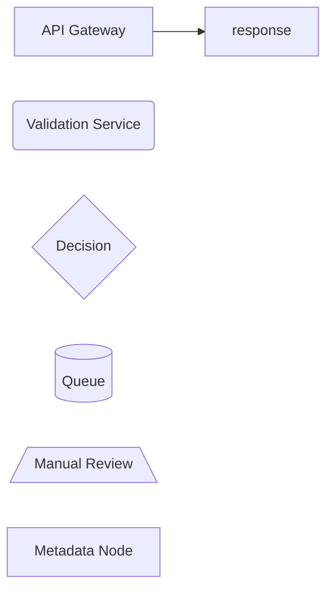
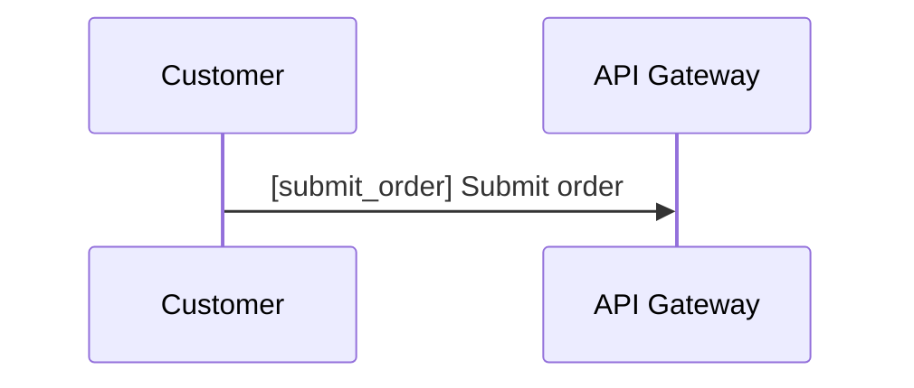
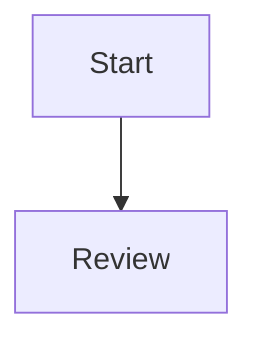
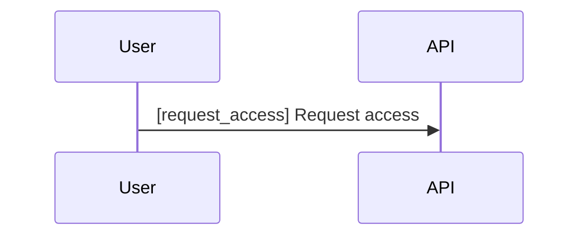
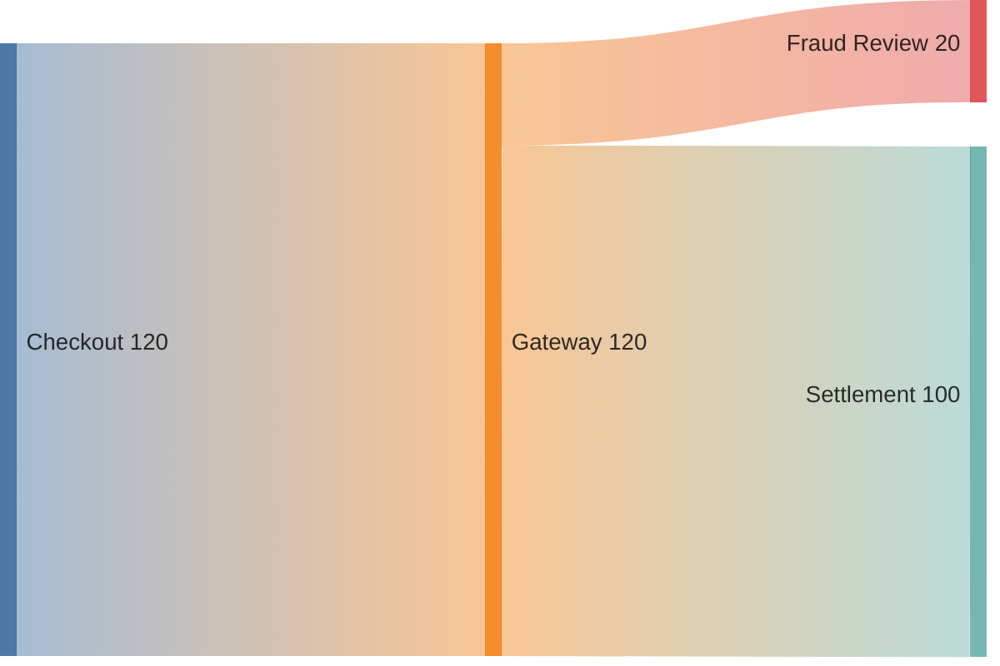

# Authoring Guide

This guide describes the current best practices for writing Diagram Tour examples and product tours.

`diagram-tours` can open a raw Mermaid diagram without a tour file. Author a `*.tour.yaml` when you want to enrich that default generated walkthrough with curated steps and prose.

It also supports Markdown files that contain fenced ```mermaid blocks. This is especially useful when AI tools place diagrams inside `.md` files instead of standalone `.mmd` files.

## Start with Stable Mermaid IDs

Every diagram element that may appear in `focus` or `{{references}}` needs a stable, addressable Mermaid reference.

Use readable, stable IDs:



Flowchart IDs must match `[A-Za-z][A-Za-z0-9_]*`. Common Mermaid node shapes are addressable when they have an ID, including square, round, diamond, circle, database, subroutine, stadium, trapezoid, parallelogram, and `@{ shape: ..., label: ... }` forms. Bare linked endpoints like `api_gateway --> response` are addressable too, with the ID as their fallback label.

Decision trees can use a `flowchart TD` diagram with focusable nodes and branches, or a Mermaid Mindmap with focusable topics. Every flowchart link is a focus target. Keys are `transition-<source-id>-to-<target-id>-<label-in-kebab-case>`; unlabeled links use `unlabeled`, punctuation-only labels use `branch`, and repeated keys receive a numeric suffix in source order. Those generated keys are reserved too, so an earlier unlabeled edge cannot take a later labeled edge's suffixed key. The edge path and visible label focus together. Nested `subgraph` boundaries are also focusable: explicit IDs use `group-<source-id>`, including IDs that begin with an underscore or digit (`subgraph _region[Region]` → `group-_region`; `subgraph 123[Numeric]` → `group-123`). Title-only groups use `group-<parent-path>-<normalized-title>` with duplicate suffixes in source order. Unquoted multiword titles such as `subgraph Region One` are supported. Title normalization lowercases text and replaces each run of non-letter/digit characters with `-`. Nodes and connectors inside a focused group remain separate targets. Classes, styles, and `click` tooltips stay visual metadata. Mermaid Mindmaps make each topic focusable while their hierarchy remains context. See the paired [`flowchart`](../examples/decision-tree/eligibility-flowchart.tour.yaml), [`component platform`](../examples/flowchart/component-platform.tour.yaml), and [`Mindmap`](../examples/decision-tree/eligibility-mindmap.tour.yaml) examples.

Prefer:

- lowercase snake_case
- IDs that survive label rewrites
- IDs that describe the role, not the current copy

Avoid:

- generated-looking IDs
- IDs that depend on presentation wording
- renaming IDs just because the label changed

For sequence diagrams, declare each participant or actor explicitly. Give a message a stable ID by prefixing its text with `[message_id] `:



In that example:

- `customer` and `api` are participant IDs
- `submit_order` is the message ID
- the user-facing label for `submit_order` is `Submit order`

Sequence focus keys use the declared participant or actor ID, or the explicit message ID. IDs must be unique across both kinds within one diagram. The tag is hidden from the rendered message label; Mermaid syntax around it stays intact. Untagged messages, lifelines, activation bars, notes, and `alt`/`opt`/`loop`/`par` frames remain visible context and are not focus targets. Tagged messages inside those frames remain focusable. Sequence constructs without a stable source ID stay out of the authoring contract; Mermaid-generated SVG IDs are never focus keys.

## ZenUML Focus Keys

ZenUML source uses `zenuml` and its own interaction syntax. Declared actors and participants use `actor-<source-name>` keys. Calls, messages, returns, and creations use `interaction-<parent-path>-<interaction-name>` keys. Named `if`, `while`, `for`, `forEach`, `foreach`, and `loop` blocks use `block-<parent-path>-<block-kind>-<condition>` keys. Names are lower-case kebab case, including a boundary between camel-case words; repeated semantic keys receive `-2`, `-3`, and so on in source order. Nested call and named-block keys include their parent path.

For example, `OrderService.submit()` inside `while(cartHasItems) { ... }` uses `interaction-while-cart-has-items-order-service-submit`, and the loop uses `block-while-cart-has-items`. These are parser-derived source keys, not Mermaid-generated SVG IDs. ZenUML actors may be introduced explicitly (`@Actor Customer`, `UI as Checkout UI`) or by an interaction. Mermaid's annotator symbol and display alias do not change the actor key; the source identifier does. Keep keys in step `focus` and `{{key}}` references, as in [`examples/zenuml/checkout-zenuml.tour.yaml`](../examples/zenuml/checkout-zenuml.tour.yaml).

ZenUML renders the full original source, including comments, titles, parameters, annotations, and all block delimiters. Actor declarations and interaction statements are focusable. Named conditional and loop blocks are focusable as a group, and their interactions remain individually focusable. Anonymous delimiters, `opt`, `par`, `try`, `catch`, and `finally` blocks, `else`/`catch`/`finally` markers, lifelines, rendering decorations, and comments stay contextual. Do not use generated SVG IDs as keys.

## State Diagram Focus Keys

State diagrams use `stateDiagram-v2` and preserve the complete Mermaid source for rendering. Every rendered state is focusable, including standalone state IDs, nested/composite states, and pseudostates declared with `<<choice>>`, `<<fork>>`, `<<join>>` or their `[[...]]` forms. Implicit states introduced by a transition are focusable too. A bare `state Waiting` declaration does not render by itself and has no focus target. Mermaid merges repeated raw state IDs across composite scopes into one rendered state; the first occurrence supplies its focus key. Use unique source IDs when the tour needs separate targets. Mermaid's `Active: Sending request` form uses `Active` as the source ID and `Sending request` as the visible label. Labels use a quoted alias when present, otherwise the first `StateId: title` description, otherwise the source ID.

State keys use `state-<parent-path>-<state-id>`. The source ID and each parent ID are normalized to lower-case kebab case; camel-case boundaries become hyphens. For example, `state "In review" as InReview { ... }` uses `state-in-review`, and its `review_decision` child uses `state-in-review-review-decision`. The display label comes from the quoted state label when present, otherwise from the source ID.

Every Mermaid `-->` transition rendered by Mermaid is focusable, including self-transitions and transitions to or from Mermaid's `[*]` start/end marker. Mermaid's default Dagre renderer shows only the last self-transition declared for a state; earlier same-state self-transitions remain in source but have no rendered target or focus key. Use one self-transition per state when each loop needs its own tour step. Keys use `transition-<source-state-key>-to-<destination-state-key>-<event-guard-label>`, with the Mermaid transition label normalized to kebab case. An unlabeled transition uses `unlabeled`; key collisions gain the next available numeric suffix in source order. State-key collisions are disambiguated the same way. The display label includes the visible state labels and transition text, such as `Draft → In review: submit [complete]`.

The `[*]` start/end marker itself is contextual and has no standalone key; its transition remains focusable. Direction declarations, comments, and notes remain rendered context. Mermaid `click` tooltips remain available and do not create focus keys. Use the state and transition keys in `focus` and `{{key}}` text references, as in [`examples/state/review-lifecycle.tour.yaml`](../examples/state/review-lifecycle.tour.yaml). Mermaid-generated SVG IDs are not authoring keys.

## Mindmap Focus Keys

Mindmaps use Mermaid's indentation-based hierarchy, and preserve the full source for rendering. A root may follow `mindmap` on the next line or on the same line. Every topic is focusable, including the root, shaped nodes, and topics at any depth. A unique Mermaid source ID in a shaped node is used exactly as its focus key, such as `research` in `research[Customer research]`. Plain text topics use `mindmap-<parent-path>-<topic>` keys: an ancestor with a source ID contributes that exact ID; other ancestors and the topic contribute lower-case kebab-case labels, with camel-case boundaries separated. Duplicate IDs and derived keys receive the next available numeric suffix in source order.

For example, `Interviews` nested under `plan((Release plan))` and `research[Customer research]` uses `mindmap-plan-research-interviews`. Quoted and multiline shape labels become one topic, and surrounding quotes/Markdown formatting are removed from the display label. Use focus keys in `focus` and `{{key}}` text references, as in [`examples/mindmap/release-plan.tour.yaml`](../examples/mindmap/release-plan.tour.yaml). Icons and classes attached on separate `::icon(...)` and `:::class` lines are decorations, not separate targets; emoji within a topic remains part of that topic's label. Branch lines and layout remain context, so focusing a topic keeps its hierarchy visible. Mermaid Mindmap has no native per-node tooltip syntax; the player does not invent extra Mermaid tooltips.

## Keep Tour Text Label-Friendly

Step text can interpolate Mermaid labels with `{{diagram_element_id}}`.

Example:

```yaml
text: >
  The {{api_gateway}} forwards valid requests to {{validation_service}}.
```

That keeps the authored copy tied to the diagram label without repeating display names manually.

The same pattern works for sequence participants and tagged messages:

```yaml
text: >
  {{submit_order}} is the first request that leaves {{customer}} and reaches {{api}}.
```

## Use Focus Intentionally

`focus` is semantic, not a low-level camera instruction.

Use a single focus target when one node should carry the explanation:

```yaml
focus:
  - api_gateway
```

Use multiple focus targets when the relationship between nodes matters more than either node alone:

```yaml
focus:
  - payment_service
  - payment_provider
```

Use `focus: []` when the step should reset attention, summarize, or let the reader absorb the full diagram:

```yaml
focus: []
```

For sequence diagrams, `focus` may contain declared participant/actor IDs or tagged message IDs:

```yaml
focus:
  - submit_order
```

## Write Linear, Readable Steps

Version 1 tours are linear. A good step usually does one of these things:

- introduce one component
- explain one handoff
- summarize one phase
- reset context before the next section

If a step tries to explain too much, split it.

## Organize Tour Files

The current convention groups public examples by diagram type under `examples/`:

```text
examples/
  flowchart/
    checkout-payment-flow.mmd
    checkout-payment-flow.tour.yaml
    payments-platform-overview.mmd
    payments-platform-overview.tour.yaml
  sequence/
    sequence-order-sequence.mmd
    sequence-order-sequence.tour.yaml
  zenuml/
    checkout-zenuml.mmd
    checkout-zenuml.tour.yaml
  state/
    review-lifecycle.mmd
    review-lifecycle.tour.yaml
    mindmap/
      release-plan.mmd
      release-plan.tour.yaml
  sankey/
    sankey-ops-review.mmd
    sankey-ops-review.tour.yaml
```

That layout keeps contributor discovery simple while making diagram types obvious in both the repository and the runtime browse UX.

If you only have a diagram at first, this is still valid:

```text
examples/
  flowchart/
    checkout-payment-flow.mmd
```

The runtime will generate an overview step plus one step per addressable Mermaid diagram element until you add an authored tour file.

For flowcharts, generated tours keep one step per node; authored tours may focus nodes, subgraph boundaries, and labeled or unlabeled transitions. Explicit subgraph IDs can start with a letter, underscore, or digit, so `subgraph _region[Region]` and `subgraph 123[Numeric]` use keys `group-_region` and `group-123`. For sequence diagrams, that is one step per explicit participant plus one step per explicitly tagged message, in source order. For ZenUML, generated targets are declared and encountered actors, interactions, and named conditional/loop blocks in source order. For Sankey diagrams, that is one step per node in source order.

Markdown-backed diagrams are also valid:

````md
# Country Implementation Checklist


````

If a Markdown file contains more than one Mermaid block, `diagram-tours` will generate one entry per block. An authored tour that targets one of those blocks should use a fragment:

```yaml
diagram: ./checklist.md#details
```

Markdown fences can contain sequence diagrams too:

````md
# Support Sequence


````

## Setup And Scaffolding Helpers

If you want repository-local guidance for contributors or AI tools, run:

```bash
diagram-tours setup
```

That creates `.diagram-tours/instructions.md` and can optionally install a Codex subagent definition that points to the generated instructions file.

Run `setup` with no flags for the interactive flow, or use `--agent`, `--agent-path <path>`, `--no-agent`, and `--overwrite` directly.

When you want a starter authored tour without writing everything by hand, run:

```bash
diagram-tours init ./examples/flowchart/checkout-payment-flow.mmd
diagram-tours init ./fixtures/markdown/checklist.md#details
diagram-tours init ./examples/flowchart/new-flow.tour.yaml
```

`init` accepts a single target path and picks the scaffold mode from that target:

- `.mmd` or `.mermaid`: generate a sibling `*.tour.yaml` from the existing Mermaid source
- `.md`: generate a `*.tour.yaml` from a Mermaid fenced block; if the Markdown file has multiple Mermaid blocks, use `#fragment` or choose a block interactively
- `.tour.yaml`: create that YAML file from scratch and also create a sibling `.mmd` starter diagram with the same stem

Pass `--overwrite` if the destination scaffold files already exist and you intentionally want to replace them.

## Validate Common Failure Cases

The parser rejects:

- missing required root fields
- empty `steps`
- non-array `focus`
- empty or invalid diagram-element IDs in `focus`
- unknown diagram-element references in `focus`
- unknown diagram-element references in `text`
- duplicate sequence participant/message IDs inside one sequence diagram

Error messages include the source path and step number when possible, so keep steps small enough for that context to stay useful.

Use the CLI validation command while authoring:

```bash
diagram-tours validate
diagram-tours validate ./examples
diagram-tours validate ./examples/flowchart/checkout-payment-flow.tour.yaml
```

With no target, validation walks the current directory recursively and checks authored `*.tour.yaml` files only.

## Authoring Workflow

A practical local loop is:

1. run `diagram-tours init <target>` if you need a starter authored tour or an empty authored scaffold
2. start the player against the target you want to edit
3. iterate on Mermaid and YAML together
4. run `diagram-tours validate` on the file or folder you changed
5. run `bun run test`
6. run `bun run smoke` if viewport or interaction behavior changed

For the published product flow, use the global CLI:

```bash
diagram-tours serve ./examples/flowchart/checkout-payment-flow.tour.yaml
diagram-tours serve ./examples/flowchart/checkout-payment-flow.mmd
diagram-tours serve --open ./docs/interview-offers-pipeline.md
diagram-tours serve ./examples
diagram-tours
diagram-tours validate ./examples/flowchart/checkout-payment-flow.tour.yaml
diagram-tours validate ./examples
```

For repository contributor work, the Bun helpers still exist:

```bash
bun run dev ./examples/flowchart/checkout-payment-flow.tour.yaml
bun run dev ./examples/flowchart/checkout-payment-flow.mmd
bun run dev ./examples
bun run dev:open
bun run dev:interactive
```

The environment-variable flow still works when you want to drive the runtime directly:

PowerShell example:

```powershell
$env:DIAGRAM_TOUR_SOURCE_TARGET = "./examples/flowchart/checkout-payment-flow.tour.yaml"
bun run dev
```

## Example Fixtures

Use the repository examples as references:

- `checkout-payment-flow` for a small authored flowchart
- `sankey-ops-review` for a small authored Sankey
- `sequence-order-sequence` for an authored Mermaid sequence diagram
- `review-lifecycle` for nested states, transitions, and choice/fork/join focus
- `release-plan` for nested mindmap topics with source IDs and derived parent-path keys
- `payments-platform-overview` for a large authored demo that stresses minimap, zoom, and pan

For Sankey diagrams, use common Mermaid `sankey-beta` CSV rows. Authored references use raw visible node labels, not generated IDs:



```yaml
steps:
  - focus:
      - Gateway
      - Fraud Review
    text: >
      {{Gateway}} may send traffic through {{Fraud Review}}.
```

If a visible Sankey label appears more than once, the first source-order match wins.

## C4 Architecture

Deployment nodes accept a named `$type` display argument. If omitted, Mermaid displays the default type `[node]`. The rendered type is part of the group's identity, so the `deployment-<alias>` focus key maps to the native group and child focus keys resolve within that scope.

Mermaid's pinned C4 renderer supports `C4Context`, `C4Container`, `C4Component`, `C4Dynamic`, and `C4Deployment`. Focus keys use source aliases: `person-<alias>`, `system-<alias>`, `container-<alias>`, `component-<alias>`, and `deployment-<alias>`. `Boundary`, `Enterprise_Boundary`, `System_Boundary`, and `Container_Boundary` use `boundary-<alias>`; deployment node declarations use `deployment-<alias>`. Relationships use `relationship-<source-order-number>`; their display labels include endpoints, relationship text, and Mermaid's visible `[technology]` text. Named arguments such as `$descr="..."`, `$techn="..."`, and `$tags="..."` are read by field name even when they occupy different argument slots. Parentheses at the end of a relationship label remain part of that label. Keys do not depend on visible labels or Mermaid-generated SVG IDs.

Mermaid 11.13.0 replaces an earlier relationship when a later `Rel` has the same directed endpoints, while keeping it at the first render position. Only the final visible relationship for an endpoint pair has a focus key. For example, after `Rel(a,b,"First")`, `Rel(a,b,"Second")`, `Rel(b,c,"Third")`, Mermaid renders `Second` and `Third`; their keys remain `relationship-2` and `relationship-3`. `relationship-1` has no SVG target and an authored reference is diagnosed as unknown.

Descriptions, icons, technology, titles, and `UpdateElementStyle`, `UpdateRelStyle`, and `UpdateLayoutConfig` stay visual context; they do not create focus targets. Mermaid keeps valid syntax outside this key model in the rendered diagram. Sprite references, tags/custom stereotypes, links, and legends are unsupported by the pinned C4 renderer. Mermaid C4 does not produce native tooltips. See [`examples/c4/platform-context.tour.yaml`](../examples/c4/platform-context.tour.yaml).

## Architecture Diagrams

Mermaid `architecture-beta` uses source-ID keys: `service-<id>`, `group-<id>`, and `junction-<id>`. Connections use one-based source-order keys `connection-1`, `connection-2`, and so on. Connection labels show both endpoint IDs and port positions; endpoint IDs, T/B/L/R ports, arrowheads, and `{group}` traversal modifiers remain attached as target metadata. Mermaid 11.13.0 can assign the same SVG path ID to distinct endpoint pairs such as `a_b:R --> L:c` and `a:R --> L:b_c`; source-order mapping keeps both focusable. Mermaid builds raw edge IDs as `from-to`, and Cytoscape uses the raw junction source ID too, although the final SVG rect gets a `node-` prefix. Validation rejects edge IDs that collide with another edge or a service, group, or junction ID. Keep endpoint and junction IDs unique; route parallel connections through a junction whose ID is distinct from every generated edge ID. Invalid sources remain visible as skipped diagnostics while other entries stay available. Empty groups such as `group aa-bb(cloud)[Empty]` render and can be focused. Groups focus their boundary, title, and icon; service and junction icons stay part of their owning target. Mermaid's pinned built-in architecture icons render; icon names that are not registered by Mermaid remain unsupported. `align` is outside Mermaid 11.13.0's syntax. Architecture diagrams have no native tooltip output. See [`examples/architecture/platform-topology.tour.yaml`](../examples/architecture/platform-topology.tour.yaml).

Each Mermaid fence in a Markdown file is discovered as an independent diagram source. If one Architecture fence has a renderer ID collision, that block is listed as a skipped diagnostic using its heading fragment; valid sibling fences and other diagram files remain in the collection.

## Deployment and Cloud Diagrams

Deployment tours reuse the existing keys for `architecture-beta` or a styled Flowchart; cloud providers, regions, networks, subnets, compute, and data stores do not add another focus-key system. Use [`examples/architecture/cloud-deployment.tour.yaml`](../examples/architecture/cloud-deployment.tour.yaml) or [`examples/flowchart/cloud-deployment.tour.yaml`](../examples/flowchart/cloud-deployment.tour.yaml) as starting points. Both tours keep duplicate database labels distinct by source ID and show one-way and bidirectional routes.

For `architecture-beta`, use built-in `cloud`, `server`, and `database` icons unless the host registers another Mermaid icon pack. Mermaid 11.13.0 does not emit native architecture tooltips or connector labels; bidirectional arrows render as two sibling arrow polygons. Keep endpoint pairs unique because repeated pairs collide in Mermaid's renderer.

For Flowcharts, use `subgraph` IDs for meaningful deployment boundaries and source node IDs for resources. `classDef`, `class`, `style`, and `linkStyle` preserve provider colors and remain styling metadata; `click` titles keep their native browser tooltip. A Flowchart `<-->` connector renders one path with `marker-start` and `marker-end` arrowheads.
