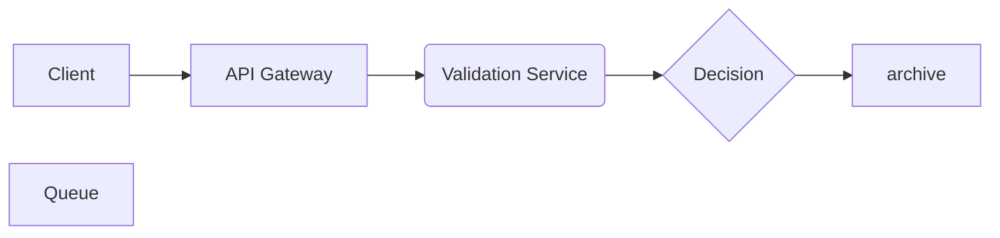
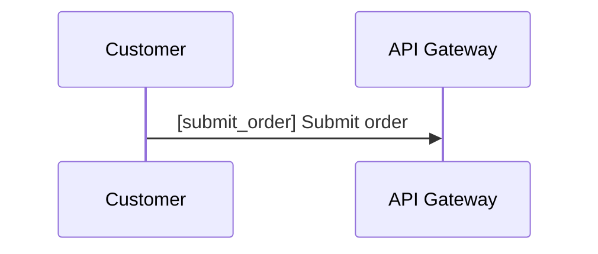
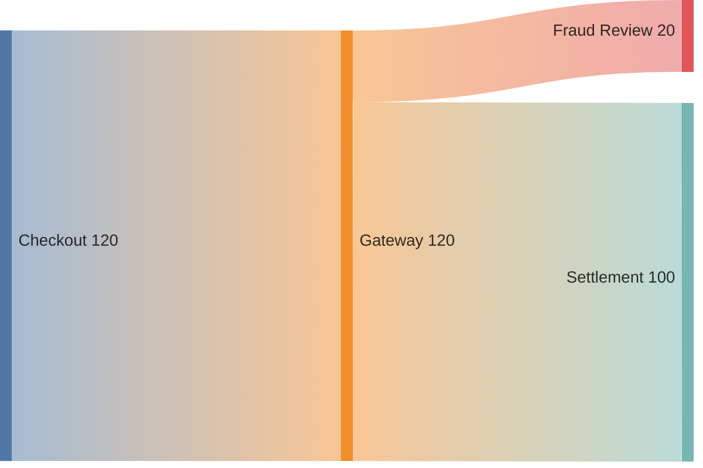

# Tour Specification v1

This document defines version 1 of the Diagram Tour contract.

A tour is a guided walkthrough over a Mermaid diagram. Version 1 is intentionally small, linear, and predictable.

This document describes the authored YAML contract. The runtime can also generate fallback tours directly from Mermaid diagrams when no YAML tour is present, but that generation behavior is not part of the `tour.yaml` schema itself.

Changes to this contract must be accompanied by updated tests and synchronized documentation.

## Goals

Version 1 prioritizes:

- simplicity
- readability
- predictable parsing
- easy authoring

## File Format

Tours are authored as YAML when you want to enrich a Mermaid diagram with curated steps.

Example:

```yaml
version: 1
title: Payment Flow
diagram: ./flowchart/checkout-payment-flow.mmd

steps:
  - focus:
      - api_gateway
    text: >
      The {{api_gateway}} receives requests from {{client}}.

  - focus:
      - validation_service
    text: >
      The {{validation_service}} verifies the request before processing.
```

## Root Fields

### `version`

Required.

```yaml
version: 1
```

Only version `1` is supported.

### `title`

Required.

```yaml
title: Payment Flow
```

Must be a non-empty string.

### `diagram`

Required.

```yaml
diagram: ./flowchart/checkout-payment-flow.mmd
```

Must be a non-empty string path to a Mermaid diagram source.

Supported authored targets include:

- standalone Mermaid files such as `./flowchart/checkout-payment-flow.mmd`
- Markdown files with fenced Mermaid blocks such as `./checklist.md`

If a Markdown file contains multiple Mermaid blocks, the path must include a fragment that selects one block:

```yaml
diagram: ./checklist.md#details
```

The referenced diagram must contain addressable Mermaid references.

For flowcharts, that means node IDs that start with a letter and then use only letters, digits, or underscores:

```mermaid
api_gateway[API Gateway]
decision{Decision}
queue[(Queue)]
manual_review[/Manual Review\]
metadata@{ shape: rect, label: "Metadata Node" }
api_gateway --> response
```

Bare linked endpoints such as `api_gateway --> response` are addressable too. Their fallback label is the ID until the diagram later gives that ID an explicit label.

For sequence diagrams, that means:

- explicit participant or actor declarations such as `participant api as API Gateway`
- explicit message IDs inside the message text such as `api->>db: [validate_request] Validate request`

### `steps`

Required.

```yaml
steps:
  - ...
```

Must be a non-empty array.

Tours are linear in version 1. Branching is not supported.

## Step Fields

Each step must be an object with:

- `focus`
- `text`

Example:

```yaml
- focus:
    - api_gateway
  text: >
    The {{api_gateway}} receives requests from {{client}}.
```

### `focus`

Required.

```yaml
focus:
  - api_gateway
  - validation_service
```

Rules:

- must be an array
- may contain zero or more diagram-element IDs
- each entry must be a non-empty string
- each ID must exist in the Mermaid diagram

Valid examples:

```yaml
focus: []
```

```yaml
focus:
  - api_gateway
```

```yaml
focus:
  - payment_service
  - payment_provider
```

`focus: []` is valid and represents a step with no specific diagram-element emphasis. A player may use that for an overview, neutral state, or context reset.

### `text`

Required.

```yaml
text: >
  The {{api_gateway}} receives requests from {{client}}.
```

Must be a non-empty string.

The text may reference diagram elements through inline references.

## Diagram Element References

Inside step text, diagram-element references use this syntax:

```text
{{node_id}}
```

Example:

```text
The {{api_gateway}} sends the request to {{validation_service}}.
```

Resolution behavior:

1. locate the referenced diagram-element ID in the Mermaid diagram
2. read the element label
3. replace the reference with that label

Example:

```text
The {{api_gateway}} forwards requests.
```

becomes:

```text
The API Gateway forwards requests.
```

## Validation Rules

A tour is invalid if any of the following are true:

- the document root is not an object
- `version` is missing
- `version` is not `1`
- `title` is missing
- `title` is not a non-empty string
- `diagram` is missing
- `diagram` is not a non-empty string
- `steps` is missing
- `steps` is not an array
- `steps` is empty
- a step is not an object
- `focus` is not an array
- a `focus` entry is empty or not a string
- a `focus` entry references an unknown Mermaid diagram element ID
- `text` is missing
- `text` is not a non-empty string
- `text` references an unknown Mermaid diagram element ID

Errors should be descriptive and actionable.

The current parser includes contextual information such as the tour source path and, when relevant, the step number, field, and source line/column when that location can be mapped from the authored YAML.

Example:

```text
Tour "examples/flowchart/checkout-payment-flow.tour.yaml": step 2 focus references unknown Mermaid node ID or transition key "validation"
```

The published CLI exposes that validation through:

```bash
diagram-tours validate
diagram-tours validate ./examples
diagram-tours validate ./examples/flowchart/checkout-payment-flow.tour.yaml
```

Validation is authored-tour focused:

- a single `*.tour.yaml` target validates exactly that file
- a directory target validates authored `*.tour.yaml` files recursively beneath it
- raw diagrams are not considered validation targets for this command

When a workspace contains invalid authored tours, the player may still load valid tours and expose the skipped authored files through the `Issues` panel with grouped per-file diagnostics.

## Mermaid Requirements

Version 1 supports Mermaid flowcharts, sequence diagrams, state diagrams, Entity Relationship diagrams, ZenUML diagrams, class diagrams, and common Sankey diagrams.

Flowchart node IDs must match `[A-Za-z][A-Za-z0-9_]*`.



In this example, the usable IDs are:

```text
client
api_gateway
validation_service
decision
archive
queue
```

Flowchart labels can come from common Mermaid node forms such as `id[Label]`, `id(Label)`, `id{Label}`, `id((Label))`, bracket variants like database or trapezoid nodes, and `id@{ shape: ..., label: "Label" }`. Bare linked endpoints such as `archive` use the ID as the fallback label. If the same ID appears later with a new explicit label, the first source position is kept and the latest explicit label is used.

Labeled flowchart links are focusable transitions in authored tours. Both `decision -->|Yes| approved` and `decision -- No --> review` produce the key `transition-decision-to-approved-yes` and `transition-decision-to-review-no`, respectively. The key uses source and target node IDs plus the link label normalized to lower-case kebab case; punctuation-only labels use `branch`, and repeated keys receive the next available numeric suffix in source order. The displayed element label is `Source → Target: Label`. Focusing a transition focuses its rendered edge and label while leaving endpoint nodes as separate focus targets. Unlabeled links remain structural context. Generated flowchart tours keep their existing overview plus one step per node behavior. The full Mermaid source, including Mermaid `click` tooltips, is preserved; tooltips remain UI affordances rather than focus targets. See [`examples/decision-tree/eligibility-flowchart.tour.yaml`](../examples/decision-tree/eligibility-flowchart.tour.yaml).

Sequence diagrams support two addressable element kinds:

- participants declared with `participant` or `actor`; use their Mermaid source IDs
- messages whose labels begin with `[message_id] `

Example:



In this example, the usable IDs are:

```text
customer
api
submit_order
```

The user-facing label for `submit_order` is `Submit order`.

Within one sequence diagram, addressable participant IDs and message IDs must be unique across the whole diagram.

Sequence focus elements and generated overview targets follow their source order. The `[message_id]` tag is hidden from the rendered message label. All other valid Mermaid syntax remains in the render source. Lifelines, activation bars, notes, and `alt`, `opt`, `loop`, `par`, `critical`, and other sequence frames are rendered context, not independent focus targets. A tagged message inside a frame remains focusable. An untagged message is not a focus target. These context constructs have no stable independent source ID in this contract, so authors must not use Mermaid-generated SVG IDs.

ZenUML diagrams use the Mermaid `zenuml` syntax and preserve the complete source for Mermaid rendering. Their focus keys are parser-derived: actors use `actor-<source-name>`; interactions use `interaction-<parent-path>-<interaction-name>`; named `if`, `while`, `for`, `forEach`, `foreach`, and `loop` groups use `block-<parent-path>-<block-kind>-<condition>`. Names use lower-case kebab case with camel-case boundaries. Nested call and named-block keys include their source parent path. Repeated semantic keys are disambiguated with `-2`, `-3`, etc. in source order. For example, `OrderService.submit()` inside `while(cartHasItems) { ... }` is `interaction-while-cart-has-items-order-service-submit`, and the loop is `block-while-cart-has-items`. Authors use these keys in `focus` and `{{key}}` text references; Mermaid-generated SVG IDs are not stable authoring keys.

Explicit actor declarations and actors inferred from interactions, calls, messages, creations, and returns are focusable. Named conditional and loop groups focus the rendered group while their inner interactions remain independently focusable. Lifelines and rendering decorations, comments, titles, anonymous delimiters, `else`/`catch`/`finally` markers, and anonymous `opt`, `par`, `try`, `catch`, and `finally` blocks remain context. Unknown ZenUML references identify the expected actor, interaction, or block key in their diagnostic. See [`examples/zenuml/checkout-zenuml.tour.yaml`](../examples/zenuml/checkout-zenuml.tour.yaml) for an authored tour.

State diagrams use `stateDiagram-v2` and preserve their full source. Rendered named and implicit states, including standalone state IDs, nested/composite states, and `<<choice>>`, `<<fork>>`, and `<<join>>` pseudostates (or `[[...]]` forms), use `state-<parent-path>-<state-id>` keys. A bare `state Waiting` declaration does not render by itself and has no focus key. Mermaid merges repeated raw state IDs across composite scopes into one rendered state, keyed by its first occurrence; use unique source IDs when separate focus targets are needed. IDs are normalized to lower-case kebab case with camel-case boundaries. State display labels use a quoted alias label, otherwise the first Mermaid `StateId: Visible label` description, otherwise the source ID. Rendered Mermaid `-->` transitions, including self-transitions and transitions using `[*]`, are focusable with `transition-<source-state-key>-to-<destination-state-key>-<event-guard-label>`; unlabeled transitions use `unlabeled`, and collisions receive the next available numeric suffix in source order. Mermaid's default Dagre renderer collapses multiple self-transitions on the same state into the last declared loop, so only that visible loop receives a focus key; earlier loops have no rendered target. Display labels combine the source state, destination state, and transition label. The `[*]` marker, direction declarations, notes, and comments remain context; Mermaid `click` tooltips remain available but are not focus targets. Mermaid-generated SVG IDs are not stable authoring keys. See [`examples/state/review-lifecycle.tour.yaml`](../examples/state/review-lifecycle.tour.yaml).

Mindmaps use the first real Mermaid `mindmap` header and preserve their full source. The header may include its root on the same line or place it on the next line. Every topic is a focus target, including the root, shaped topics, and topics at every depth. A unique shaped node's Mermaid source ID is used exactly as its focus key. A plain text topic uses `mindmap-<parent-path>-<topic>`: each ancestor with an ID contributes that exact ID, while other ancestors and the topic contribute lower-case kebab-case labels with camel-case boundaries separated. Duplicate IDs and derived keys receive the next available numeric suffix in source order. For example, `Interviews` beneath `plan((Release plan))` and `research[Customer research]` uses `mindmap-plan-research-interviews`. Focus keys are stable authoring IDs, not Mermaid-generated SVG node numbers. Quoted, bracketed, and multiline shape labels remain one focus target; quotes and Markdown formatting are removed from the display label. Branch connectors, indentation, and layout are structural context and stay visible when a topic is focused. Separate `::icon(...)` and `:::class` decoration lines are not targets; emoji in a topic remains part of its label. Mermaid Mindmap has no native per-node tooltip syntax, so Mermaid-specific tooltips are not produced. See [`examples/mindmap/release-plan.tour.yaml`](../examples/mindmap/release-plan.tour.yaml).

Entity Relationship diagrams use Mermaid `erDiagram` syntax and preserve their complete source. Entities use their Mermaid source IDs as focus keys; any entity alias changes its display label only. Attributes use `attribute-<entity-slug>-<attribute-slug>`, with duplicate keys disambiguated by a source-order numeric suffix. Each attribute target includes its whole rendered row with type, name, PK/FK/UK markers, and comment; its display label is `Entity.attribute`. Relationships use `relationship-<source-slug>-to-<target-slug>-<role-slug>-<source-cardinality>-<identifying-type>-<target-cardinality>`. Slugs lowercase text, remove accents, and replace punctuation or whitespace with hyphens. Cardinality slugs are `one`, `zero-or-one`, `one-or-more`, `zero-or-more`, and `unknown`; line types are `identifying` or `non-identifying`. Unlabeled relationship roles use `relationship`. For example, `CUSTOMER ||--o{ SALES_ORDER : places` uses `relationship-customer-to-sales-order-places-one-identifying-zero-or-more` and displays `CUSTOMER — places → SALES_ORDER (one, identifying, zero-or-more)`. Mermaid role formatting is resolved to visible text for keys and labels; role text is never used to match the SVG target. The player validates native edge identity, endpoint cardinalities, and solid/dashed line type before annotating a relationship. Focusing a relationship highlights the connector and its label together; its endpoints remain independent entity targets. For self-referencing relationships on one entity, only the latest has an independent focus key because Mermaid 11.13 reuses the same synthetic path and label IDs for earlier loops. Entity titles, style metadata, and separators remain context. Mermaid 11.13's ER syntax has no native click-tooltip directive. See [`examples/entity-relationship/order-fulfillment.tour.yaml`](../examples/entity-relationship/order-fulfillment.tour.yaml).

## Focus Semantics

The `focus` field is semantic, not a strict UI instruction.

The contract says which diagram elements matter for a step. The player decides how to render that meaning.

Typical UI behavior may include:

- highlighting focused nodes
- highlighting focused participants or messages
- dimming non-focused nodes
- centering the viewport
- keeping an overview when focus is empty

The specification intentionally does not mandate one rendering strategy.

## Scope of Version 1

Supported:

- Mermaid flowcharts
- Mermaid state diagrams with nested/composite states, transitions, and choice/fork/join focus keys
- Mermaid mindmaps with root and nested topic focus keys
- Mermaid Entity Relationship diagrams with entity, attribute-row, and relationship focus keys
- Mermaid sequence diagrams with addressable participants and tagged messages
- Mermaid ZenUML diagrams with source-derived actor, interaction, and named conditional/loop focus keys
- Common Mermaid Sankey diagrams with addressable node labels
- Mermaid Requirement diagrams with focusable requirement and element blocks plus typed traceability relations
- YAML tour files
- sequential tours
- element highlighting or other player-defined focus rendering
- inline diagram-element references in text
- empty-focus steps

Not supported:

- branching tours
- multiple diagrams in one tour
- audio narration
- conditional steps
- player-specific viewport instructions in the tour file
- Independent focus keys for sequence lifelines, activation bars, notes, untagged messages, and sequence frames
- Independent focus keys for state diagram `[*]` markers, directions, notes, and comments
- Independent focus keys for mindmap branch connectors, indentation/layout, and icon/class decoration lines
- Independent focus keys for ZenUML delimiters, anonymous blocks, lifelines, and rendering decorations
- unlabeled flowchart links, Mermaid styles/classes, and subgraph boxes as addressable elements; Mermaid `click` tooltips are not focus targets
- Stable authored Sankey link references
- Independent focus keys for Requirement properties, accessibility metadata, classes/styles, comments, or Mermaid-generated SVG identifiers; requirement diagrams have no native click-tooltip syntax
- Independent focus keys for ER entity titles, row separators, comments, and styles; Mermaid 11.13 ER syntax has no native click-tooltip directive

## Future Directions

Potential future features include:

- branching tours
- audio narration
- step identifiers
- multi-diagram tours
- interactive steps
- plugin extensions

These are intentionally excluded from version 1.

## Philosophy

Version 1 aims to feel like writing an explanation, not configuring a UI runtime.
Sankey diagrams support addressable nodes by raw visible label:



- `Gateway`
- `Fraud Review`
- `Settlement`

If the same visible Sankey label appears more than once, the first source-order match wins.
